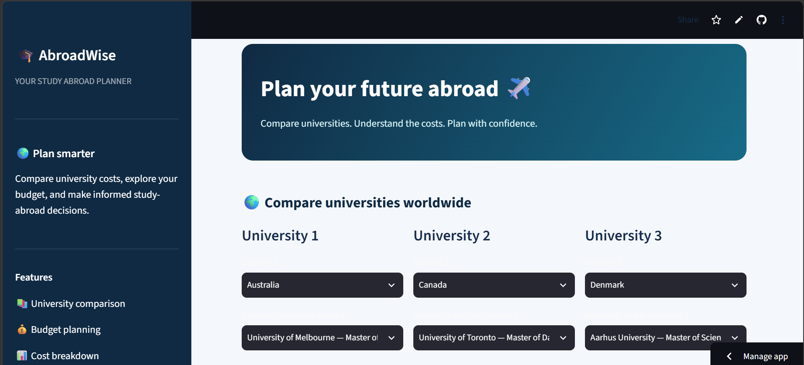
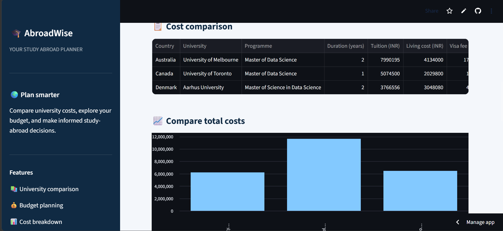
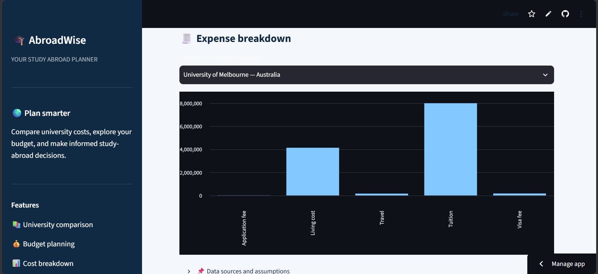

# AbroadWise — Study Abroad Budget Planner

**AbroadWise** is a Python-based web application that helps students compare university costs and plan their study-abroad budgets.

## Live Demo
Open the deployed application: **[AbroadWise Web App](PASTE_YOUR_STREAMLIT_URL_HERE)**

## Features
- Compare universities across different countries.
- Estimate tuition and living expenses.
- Include visa fees, application fees, travel costs, and scholarships.
- Check estimated costs against a personal budget.
- Visualize university costs using charts.
- Download university comparison reports as CSV files.

## Technologies Used
- Python
- Streamlit
- Pandas
- CSV datasets
- GitHub
- Streamlit Community Cloud

## How to Run Locally

1. Clone this repository.
2. Install the required packages:

   `pip install -r requirements.txt`

3. Run the application:

   `streamlit run app_v3.py`
   ## Application Screenshots

### Home Page

### University Comparison

### Cost Charts and Report

## Project Purpose
This project was created to explore Python programming, data handling, data visualization, and web application development through a practical student-focused use case.

## Important Note
The displayed costs are estimates. Exchange rates are approximate, and users should verify tuition fees and other expenses with official sources before making financial decisions.

URL:https://abroadwise-madhumitha.streamlit.app/
